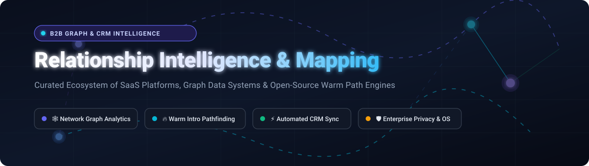

  

# 🌐 Awesome Relationship Intelligence & Mapping 🗺️

**A curated index of enterprise SaaS products, graph database engines, network algorithms, and open-source personal/business relationship management tools.**

*Empower revenue operations, sales leaders, investment banking professionals, venture capitalists, and developers to map network graphs, discover warm introduction paths, and automate CRM enrichment.*

---

## 📑 Table of Contents
- [📊 Sector Overview & Market Dynamics](#-sector-overview--market-dynamics)
- [🏢 SaaS / Hosted Platforms](#-saas--hosted-platforms)
- [🔓 Open-Source GitHub Projects](#-open-source-github-projects)
- [📈 Star History](#-star-history)
- [🤝 How to Contribute](#-how-to-contribute)
- [⚖️ Disclaimer & Compliance](#️-disclaimer--compliance)

---

## 📊 Sector Overview & Market Dynamics

The global Relationship Intelligence and Sales Engagement software market is valued at approximately **$4.8 billion to $5.5 billion (2025–2026)** and is projected to expand at an annual growth rate (CAGR) of over **14.2%**, driven by the integration of AI copilots, automated inbox/calendar telemetries, and automated contact graph enrichment.

The sector is currently **moderately fragmented**: mega-cap CRM incumbents (such as Salesforce and ZoomInfo) hold strong platform gravity and dominate core enterprise accounts, while specialized, high-margin vertical segments (such as private equity, venture capital, executive search, and investment banking) remain competitive fiefdoms captured by purpose-built relationship intelligence engines like Affinity, Introhive, DealCloud, and BoardEx. At the foundational layer, modern open-source graph frameworks and self-hosted CRMs provide organizations with total data sovereignty, avoiding vendor lock-in for proprietary relationship data.

---

## 🏢 SaaS / Hosted Platforms

The following enterprise platforms specialize in automated relationship extraction, deal committee mapping, interaction scoring, and warm referral discovery. Sorted in descending order by **Market Valuation / Annual Revenue**:

| Product 🏷️ | Valuation / Annual Revenue 💰 | Starting Pricing Tier 💳 | Free Tier & Trial Limits ⏳ | Core Focus & Relationship Intelligence Capabilities 🔍 |
| :--- | :--- | :--- | :--- | :--- |
| **[Salesforce Einstein Relationship Insights](https://www.salesforce.com/)** | **~$300B Valuation** (~$38B Annual Revenue) | **$50 / user / month** (*Starter Tier*; $150/user/mo for Standard) | **30-day free trial** with full Salesforce CRM sandbox access (no permanent free tier) | Native AI-powered graph extraction scanning internal CRM history, enterprise emails, and external web sources to uncover decision-maker networks. |
| **[ZoomInfo Chorus](https://www.zoominfo.com/)** | **~$4.5B Valuation** (~$1.25B Annual Revenue) | **~$1,200 / user / year** (~$100/mo billed annually; platform fee applies) | **14-day free trial** with restricted record exports and transcription credits (no permanent free tier) | Interaction tracking, speech conversation analytics, buying committee momentum scoring, and automated CRM activity capture. |
| **[DealCloud](https://www.dealcloud.com/)** *(by Intapp)* | **~$3.8B Valuation** (Intapp parent ~$450M+ ARR) | **~$125 / user / month** (Billed annually; custom onboarding fee) | **No free tier**; guided sandbox pilot/demo available upon enterprise qualification | Purpose-built financial services deal pipeline management with Relationship Intelligence API extracting network paths from inbox/calendar streams. |
| **[Altrata](https://altrata.com/)** *(by Delinian)* | **~$1.5B Valuation** (Delinian private group) | **~$1,500 / user / year** (Corporate subscriptions for intelligence datasets) | **7-day trial access** or curated preview access on request (no permanent free tier) | Master executive intelligence conglomerate encompassing BoardEx, RelSci (Relationship Science), WealthEngine, and Wealth-X. |
| **[Affinity](https://www.affinity.co/)** | **~$700M Valuation** (~$50M+ ARR) | **$180 / user / month** (*Essential Tier*, billed annually) | **14-day free trial** on select plans via sales demo approval (no permanent free tier) | Relationship-first CRM for VC, PE, and M&A; extracts mailbox/calendar data to calculate relationship strength scores and pinpoint warm intros. |
| **[Leadspace](https://www.leadspace.com/)** | **~$350M Valuation** (~$40M+ ARR) | **~$25,000 / platform / year** (~$2,083/mo starting enterprise contract) | **No free tier**; interactive data audit & pipeline match sample report upon request | B2B Customer Data Platform (CDP) and identity resolution engine identifying buying centers, account graphs, and predictive ICP signals. |
| **[Introhive](https://www.introhive.com/)** | **~$250M Valuation** (~$30M ARR) | **~$50 / user / month** (Billed annually for enterprise deployments) | **14-day proof of concept (PoC)** / guided trial for enterprise teams (no permanent free tier) | Enterprise relationship capital mapping for law, accounting, and consulting firms; cleans CRM records and tracks connection strength. |
| **[Relationship Science (RelSci)](https://relsci.com/)** | **~$150M Asset Valuation** *(Altrata division)* | **$83.33 / user / month** ($1,000 billed annually for individual access) | **Limited free search profile preview** with 0 contact export credits (no permanent free tier) | Deep decision-maker graph mapping over 6 million executives and board members with multi-hop Path Finder connection calculations. |
| **[BoardEx](https://www.boardex.com/)** | **~$120M Asset Valuation** *(Altrata division)* | **~$250 / user / month** (~$3,000/year minimum single-seat license) | **Sample report demo** upon consultative sales verification (no permanent free tier) | Proprietary executive network intelligence mapping 2M+ global organizations and 1.6M+ C-suite leaders to uncover board overlaps and executive paths. |
| **[Nektar.ai](https://nektar.ai/)** | **~$40M Valuation** (~$5M ARR) | **$39 / user / month** (Billed annually for automated capture) | **14-day free trial** with automated scan of historical inbox and calendar data | Zero-adoption revenue data foundation preventing data decay by capturing hidden contacts, meeting participants, and multi-threaded buying groups. |

---

## 🔓 Open-Source GitHub Projects

Explore open-source alternatives, graph databases, network analysis algorithms, entity resolution engines, and self-hosted personal CRMs. Sorted in descending order by **GitHub Star Count**:

| Project 📦 | Stars ⭐ | Primary Technology 💻 | Description & Relationship Capabilities 💡 |
| :--- | :--- | :--- | :--- |
| **[Apache Superset](https://github.com/apache/superset)** |  | Python, TypeScript | Modern enterprise business intelligence platform equipped with network chart plugins and interactive relationship analytics dashboards. |
| **[Twenty](https://github.com/twentyhq/twenty)** |  | TypeScript, NestJS, React | Next-generation modern open-source CRM featuring rich custom relational objects, automated metadata tracking, and developer-friendly graph APIs. |
| **[Metabase](https://github.com/metabase/metabase)** |  | Clojure, TypeScript | Effortless analytics and visualization platform for querying company connections, contact pipelines, and entity linkage charts. |
| **[Graphiti](https://github.com/getzep/graphiti)** |  | Python, Cypher | Framework for constructing real-time, temporally aware knowledge graphs from dynamic human conversations and interaction histories. |
| **[Monica](https://github.com/monicahq/monica)** |  | PHP, Laravel, Vue | Self-hosted personal relationship management (PRM) system to document meeting context, intimate life notes, family relations, and relationship cadence. |
| **[PyG (PyTorch Geometric)](https://github.com/pyg-team/pytorch_geometric)** |  | Python, C++, PyTorch | Deep learning framework for graph neural networks (GNNs), ideal for link prediction, relationship scoring, and entity affinity modeling. |
| **[Krayin CRM](https://github.com/krayin/laravel-crm)** |  | PHP, Laravel | Flexible CRM foundation offering lead management, customer interaction pipelines, and customizable contact network schemas. |
| **[Dgraph](https://github.com/dgraph-io/dgraph)** |  | Go, GraphQL | Horizontally scalable, distributed GraphQL graph database engineered for fast low-latency relationship graph traversal. |
| **[NetworkX](https://github.com/networkx/networkx)** |  | Python | The standard Python library for complex network analysis, degree centrality, community clustering, and shortest warm introduction path algorithms. |
| **[Neo4j](https://github.com/neo4j/neo4j)** |  | Java, Cypher | The preeminent native graph database engine powering complex relational traversals, multi-degree entity connections, and enterprise knowledge maps. |
| **[DGL (Deep Graph Library)](https://github.com/dmlc/dgl)** |  | Python, C++ | High-performance toolkit for building and evaluating graph neural networks on massive multi-relational graphs and interaction structures. |
| **[ArangoDB](https://github.com/arangodb/arangodb)** |  | C++, JavaScript | Multi-model database unifying graphs, documents, and search in one engine using the declarative AQL query language. |
| **[NebulaGraph](https://github.com/vesoft-inc/nebula)** |  | C++ | Ultra-high throughput distributed graph database built to manage billions of nodes and trillions of relationship edges. |
| **[Sigma.js](https://github.com/jacomyal/sigma.js)** |  | TypeScript, WebGL | WebGL-accelerated interactive graph drawing library tailored for displaying massive networks and relationship communities in the browser. |
| **[Cytoscape.js](https://github.com/cytoscape/cytoscape.js)** |  | JavaScript | Comprehensive graph theory and network visualization library supporting compound nodes, breadth-first search, and path routing. |
| **[Gephi](https://github.com/gephi/gephi)** |  | Java | Desktop visual exploratory analysis platform for analyzing social network clusters, centrality metrics, and connection densities. |
| **[JanusGraph](https://github.com/JanusGraph/janusgraph)** |  | Java, Gremlin | Highly scalable distributed graph database supporting modular storage engines (Cassandra, HBase, BerkeleyDB) and Gremlin graph computing. |
| **[SuiteCRM](https://github.com/salesagility/SuiteCRM)** |  | PHP, Symfony, Angular | Battle-tested open-source enterprise CRM offering end-to-end account history, custom modules, and relationship tracking capabilities. |
| **[Apache AGE](https://github.com/apache/age)** |  | C, SQL, Cypher | PostgreSQL extension providing openCypher graph query capabilities alongside standard relational SQL tables. |
| **[Memgraph](https://github.com/memgraph/memgraph)** |  | C++, Python, Cypher | In-memory graph analytics platform purpose-built for real-time path discovery, stream processing, and rapid graph algorithms. |
| **[Dedupe](https://github.com/dedupeio/dedupe)** |  | Python | Machine learning library for fuzzy matching, contact record deduplication, and cross-database entity resolution. |
| **[vis-network](https://github.com/visjs/vis-network)** |  | JavaScript, HTML5 Canvas | Dynamic, browser-based network visualization component designed for responsive interactive relationship clusters. |
| **[EspoCRM](https://github.com/espocrm/espocrm)** |  | PHP, JavaScript | Lightweight and extensible CRM web application with flexible relationship models, flow automation, and telephony integration. |
| **[Splink](https://github.com/moj-analytical-services/splink)** |  | Python, DuckDB, Spark | Fast probabilistic record linkage and entity resolution library capable of connecting millions of disparate contact identities. |
| **[Apache TinkerPop](https://github.com/apache/tinkerpop)** |  | Java, Gremlin | Graph computing framework standardizing the Gremlin traversal language across diverse graph engines and OLTP databases. |
| **[igraph](https://github.com/igraph/igraph)** |  | C, C++, Python, R | High-performance graph modeling library designed for fast network analysis, community partitions, and large graph math. |
| **[Graphology](https://github.com/graphology/graphology)** |  | TypeScript, JavaScript | Versatile, robust graph data structure specifications and algorithm collection for modern JavaScript and Node.js ecosystems. |
| **[Zingg](https://github.com/zinggAI/zingg)** |  | Java, Python, Spark | ML-driven identity resolution and master data management (MDM) platform running on Apache Spark to unify fragmented buyer profiles. |
| **[Relationship Substrate](https://github.com/dbmcco/relationship-substrate)** |  | Python | Structured foundation for relationship memory records, agent tool calling interfaces, and operating picture generation. |

---

## 📈 Star History

---

## 🤝 How to Contribute

We actively welcome contributions from the community! To suggest a new tool or update existing benchmarks:

1. **Fork the repository** to your own GitHub account.
2. **Review requirements**:
   - For **SaaS platforms**: Specify accurate starting prices, exact trial/free-tier constraints, company scale metrics, and core relationship mapping capabilities.
   - For **Open-Source projects**: Provide active repository link, primary stack, and relevant graph/CRM feature set.
3. **Commit your modifications** with a descriptive commit message.
4. **Submit a Pull Request (PR)** detailing the addition and source links.

---

## ⚖️ Disclaimer & Compliance

- **Community Curated**: This list is maintained for educational and informational purposes. Mention does not signify commercial endorsement.
- **Privacy & Regulatory Compliance**: Relationship intelligence, contact mining, and email synchronization systems must adhere to strict data privacy regulations including **GDPR**, **CCPA/CPRA**, and local telecommunications laws.
- **Enterprise Governance**: Self-hosting relationship graph platforms requires data retention policies, identity access management, and secure cryptographic storage of personal communication metadata.
